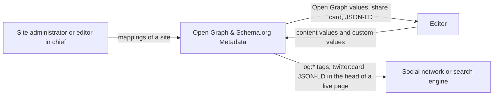
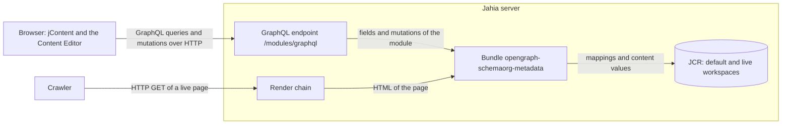

# Context and Scope

The module is one OSGi bundle inside a Jahia server. It reads the content of a site and writes two outputs: the head
of a live page, and the values that the Content Editor shows.

## Business Context

| Communication partner | Input to the module | Output of the module |
|---|---|---|
| Site administrator, editor in chief | A mapping names a content type or a mixin, a template, an og:type and a schema.org type. It also names a source property for each mapped property. | The list of the mappings of the site, and the choice lists of the mapping form. |
| Editor | The values of a content, and the custom Open Graph tags and schema.org values of that content. | The Open Graph values with a share card of Facebook, LinkedIn and X, and the JSON-LD block of the content. |
| Social network, search engine | A request for a live page. | The `og:*` meta tags, the `twitter:card` tag and the JSON-LD block in the head of the page. |

## Technical Context

| Channel | Protocol | Content |
|---|---|---|
| GraphQL endpoint of Jahia | HTTP POST of GraphQL | The fields of the module, and the generic node mutations that the Content Editor uses to save a mapping or a content. |
| Render chain of Jahia | HTTP GET of a live page | The HTML of the page, to which the render filter adds the tags. |
| JCR | Java API of Jahia | The mapping nodes in the default workspace, and the values of a content in the workspace of the request. |
| Module federation of app-shell | JavaScript remote entry | `javascript/apps/remoteEntry.js` exposes `./init`, which registers the UI extensions of the module. |
