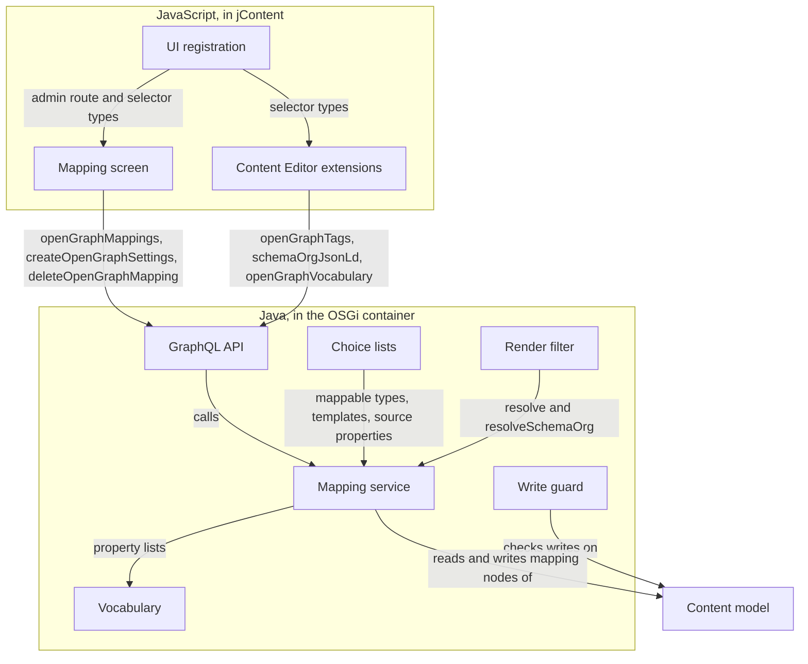
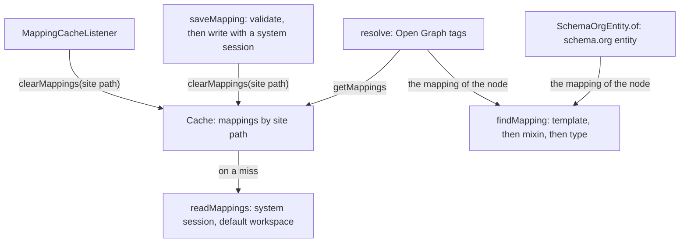

# Building Block View

## Whitebox Overall System

The module has a Java part, which runs in the OSGi container of Jahia, and a JavaScript part, which runs in jContent.
The content model ties both parts together.

| Name | Responsibility |
|---|---|
| Content model: [`definitions.cnd`](../../src/main/resources/META-INF/definitions.cnd), [`forms/`](../../src/main/resources/META-INF/jahia-content-editor-forms/forms/), [`permissions.xml`](../../src/main/import/permissions.xml), [`roles.xml`](../../src/main/import/roles.xml) | The content model declares the node types of a mapping, the mixins of the custom values, the fieldsets of the Content Editor and the permission. |
| Vocabulary: [`vocabulary/`](../../src/main/java/org/jahia/pm/modules/opengraphschemaorgmetadata/vocabulary/) | The vocabulary lists the og:types, the schema.org types and their properties, and converts a JCR value to the text of a tag. |
| Mapping service: [`OpenGraphService.java`](../../src/main/java/org/jahia/pm/modules/opengraphschemaorgmetadata/OpenGraphService.java) and the classes beside it | The mapping service stores and validates the mappings, and resolves the Open Graph tags and the schema.org entity of a content. |
| Write guard: [`MappingWriteGuard.java`](../../src/main/java/org/jahia/pm/modules/opengraphschemaorgmetadata/MappingWriteGuard.java) | The write guard refuses a change of a property of a mapping node to a user without `openGraphSchemaOrgMetadataManage` on its site. |
| Choice lists: [`choicelist/`](../../src/main/java/org/jahia/pm/modules/opengraphschemaorgmetadata/choicelist/) | The choice lists fill the fields of the mapping form in the Content Editor. |
| GraphQL API: [`graphql/`](../../src/main/java/org/jahia/pm/modules/opengraphschemaorgmetadata/graphql/) | The GraphQL API extends the schema of `graphql-dxm-provider` with the fields and the mutations of the module. |
| Render filter: [`render/`](../../src/main/java/org/jahia/pm/modules/opengraphschemaorgmetadata/render/) | The render filter writes the tags and the JSON-LD block of the main resource before the first `</head>` of a live or a preview page. |
| UI registration: [`init.tsx`](../../src/javascript/init.tsx), [`appShellRemotes.ts`](../../src/javascript/appShellRemotes.ts) | The UI registration adds the admin route and the selector types of the module to the registry of jContent. |
| Mapping screen: [`open-graph-settings/`](../../src/javascript/open-graph-settings/) | The mapping screen lists the mappings of a site, and opens the Content Editor to create or edit one. |
| Content Editor extensions: [`open-graph-preview/`](../../src/javascript/open-graph-preview/), [`schema-org-preview/`](../../src/javascript/schema-org-preview/), [`editor-tags/`](../../src/javascript/editor-tags/), [`fieldSets.ts`](../../src/javascript/fieldSets.ts) | The Content Editor extensions show the values of a content and edit its custom values in the SEO section. |

### Content model

[`definitions.cnd`](../../src/main/resources/META-INF/definitions.cnd) declares three namespaces: `osmnt` for the node
types, `osmmix` for the mixins and `osm` for the properties.

| Node type or mixin | Content |
|---|---|
| `osmnt:settings` | The settings node of a site, with `jmix:nolive`. It holds the mappings as children. |
| `osmnt:typeMapping` | One mapping: `osm:nodeType` and `osm:templateName`, where `*` stands for every template. |
| `osmmix:openGraph` | The Open Graph switch of a mapping: `osm:ogType` and one `osm:og_*` property for each property of every og:type. |
| `osmmix:article`, `osmmix:book`, `osmmix:profile`, `osmmix:music*`, `osmmix:video*` | The properties of one og:type. Each mixin inherits `jmix:dynamicFieldset`. |
| `osmmix:schemaOrg` | The schema.org switch of a mapping: `osm:schemaType`. |
| `osmmix:schemaArticle` to `osmmix:schemaVideoObject` | The `osm:schema_*` properties of one schema.org type. Each mixin inherits `jmix:dynamicFieldset`. |
| `osmmix:customTags` | The Open Graph tags that an editor sets on a page or a main resource, in `osm:customTags`. |
| `osmmix:customSchemaOrg` | The schema.org values that an editor sets on a page or a main resource, in `osm:customSchemaOrg`. |

`permissions.xml` adds `openGraphSchemaOrgMetadataManage` under the permission group `site-admin`, and `roles.xml`
grants it to the role `editor-in-chief`.

### GraphQL fields of the module

The classes of [`graphql/`](../../src/main/java/org/jahia/pm/modules/opengraphschemaorgmetadata/graphql/) extend three
types of `graphql-dxm-provider`. `OpenGraphSchemaOrgMetadataExtensionsProvider` registers them.

| Field | Extended type | Check | Result |
|---|---|---|---|
| `openGraphVocabulary` | `Query` | None | The og:types and the schema.org types, and the kind of each property. |
| `openGraphMappings` | `JCRNode`, on a site node | `openGraphSchemaOrgMetadataManage` on the site | The mappings of the site. |
| `openGraphSourceProperties(nodeType, language)` | `JCRNode`, on a site node | `openGraphSchemaOrgMetadataManage` on the site | The properties of a content type that can fill a property, with their kinds. |
| `openGraphTags(language)` | `JCRNode` | Read access to the node | The Open Graph tags of the node. A node value is a path in `nodePath`. |
| `schemaOrgJsonLd(language)` | `JCRNode` | Read access to the node | The JSON-LD text of the node, with `{"nodePath": "<path>"}` in place of each live URL. |
| `createOpenGraphSettings` | `JCRNodeMutation`, on a site node | `openGraphSchemaOrgMetadataManage` on the site | The path of the settings node, which the mutation creates when it does not exist. |
| `saveOpenGraphMapping(...)` | `JCRNodeMutation`, on a site node | `openGraphSchemaOrgMetadataManage` on the site | Creates a mapping or replaces all its values, after the validation of the service. |
| `deleteOpenGraphMapping(nodeType, templateName)` | `JCRNodeMutation`, on a site node | `openGraphSchemaOrgMetadataManage` on the site | Deletes the mapping of a content type and a template. |

`Resolvers.managedSite` makes the check on the site node. An `InvalidMappingException` of the service becomes a
`GqlJcrWrongInputException`, so the client receives the message of the validation.

## Level 2

### White Box Mapping service

The mapping service is the largest block, and the render filter, the GraphQL API and the choice lists all depend on
it.

| Name | Responsibility |
|---|---|
| [`OpenGraphService`](../../src/main/java/org/jahia/pm/modules/opengraphschemaorgmetadata/OpenGraphService.java) | The OSGi service stores, validates, selects and resolves the mappings. |
| [`TypeMapping`](../../src/main/java/org/jahia/pm/modules/opengraphschemaorgmetadata/TypeMapping.java), [`PropertyMapping`](../../src/main/java/org/jahia/pm/modules/opengraphschemaorgmetadata/PropertyMapping.java) | These immutable values hold one mapping and one mapped property, as the cache keeps them. |
| [`SourceProperty`](../../src/main/java/org/jahia/pm/modules/opengraphschemaorgmetadata/SourceProperty.java) | This value describes a property of a content type that can fill a property of a vocabulary. |
| [`OgTag`](../../src/main/java/org/jahia/pm/modules/opengraphschemaorgmetadata/OgTag.java) | One tag holds a text, or a node whose absolute URL the caller builds. |
| [`SchemaOrgEntity`](../../src/main/java/org/jahia/pm/modules/opengraphschemaorgmetadata/SchemaOrgEntity.java) | This class builds the schema.org entity of a content as an ordered map. |
| [`MappingCacheListener`](../../src/main/java/org/jahia/pm/modules/opengraphschemaorgmetadata/MappingCacheListener.java) | This JCR event listener removes the cached mappings of a site when its settings node or the site node changes. |
| [`InvalidMappingException`](../../src/main/java/org/jahia/pm/modules/opengraphschemaorgmetadata/InvalidMappingException.java) | This exception carries the message of a validation that fails. |

The service validates a mapping in `saveMapping` before it writes:

- The content type is mappable, and its module is active on the site.
- A template mapping names a template of the choice list of `j:templateName` for that type.
- The og:type and the schema.org type are values of the vocabulary, and a property needs its type.
- A property of the vocabulary is mapped once, from a source property of the content type or of a mixin that extends
  it.
- The kinds of the source property include the kind of the target property.
- A source with several values does not fill a text or a number that takes one value.

### White Box Content Editor extensions

The forms files add four fieldsets to the section `seo` of the Content Editor, ranked 10 to 13.

| Rank | Fieldset | Field and selector type | Component |
|---|---|---|---|
| 10 | `osmOpenGraphValues` | `osm:ogPreview`, `OsmPreview`, read-only | [`OgPreview.tsx`](../../src/javascript/open-graph-preview/OgPreview.tsx) with [`ShareCard.tsx`](../../src/javascript/open-graph-preview/ShareCard.tsx) |
| 11 | `osmmix:customTags` | `osm:customTags`, `OsmTag` | [`OsmTag.tsx`](../../src/javascript/editor-tags/OsmTag.tsx) with [`PropertyValue.tsx`](../../src/javascript/editor-tags/PropertyValue.tsx) |
| 12 | `osmSchemaOrgValues` | `osm:schemaPreview`, `OsmSchemaPreview`, read-only | [`SchemaPreview.tsx`](../../src/javascript/schema-org-preview/SchemaPreview.tsx) |
| 13 | `osmmix:customSchemaOrg` | `osm:customSchemaOrg`, `OsmSchemaValue` | [`OsmSchemaValue.tsx`](../../src/javascript/editor-tags/OsmSchemaValue.tsx) with [`PropertyValue.tsx`](../../src/javascript/editor-tags/PropertyValue.tsx) |

The CND declares no `osm:ogPreview` and no `osm:schemaPreview`, so the save of the form sends nothing for them. The
forms files of `jnt:page` and `jmix:mainResource` declare these two fields. The Content Editor shows the fieldsets of
rank 11 and 13 as switches, because their mixins extend `jnt:page` and `jmix:mainResource`.

`useHiddenFieldSets` in [`fieldSets.ts`](../../src/javascript/fieldSets.ts) hides fieldsets of the module after the
values load:

- When no mapping applies, or when both vocabularies are off, it hides the four fieldsets.
- When one vocabulary is off in the mapping, it hides the fieldset of the custom values of that vocabulary.

`PropertyValue` edits one custom value with the editor of the kind of its property. An image gets the image picker, a
date gets the date picker, and a text or a number gets a text field. `OsmTag` offers the properties of the og:type of the
mapping, and `OsmSchemaValue` offers the properties of its schema.org type.

## Level 3

Not documented.
