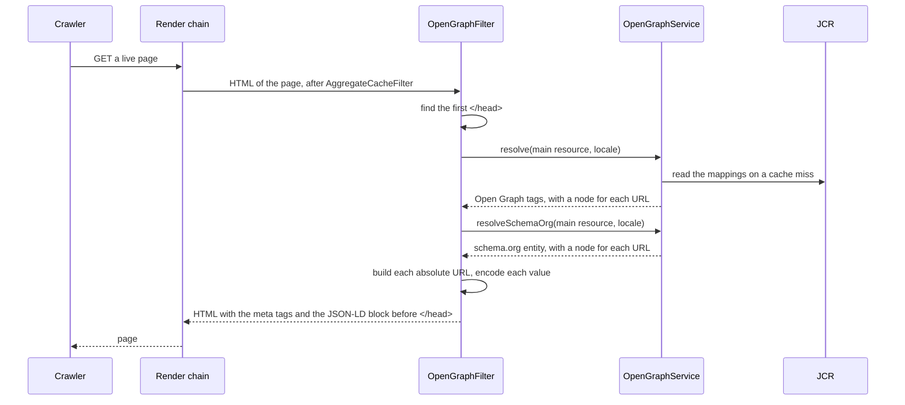
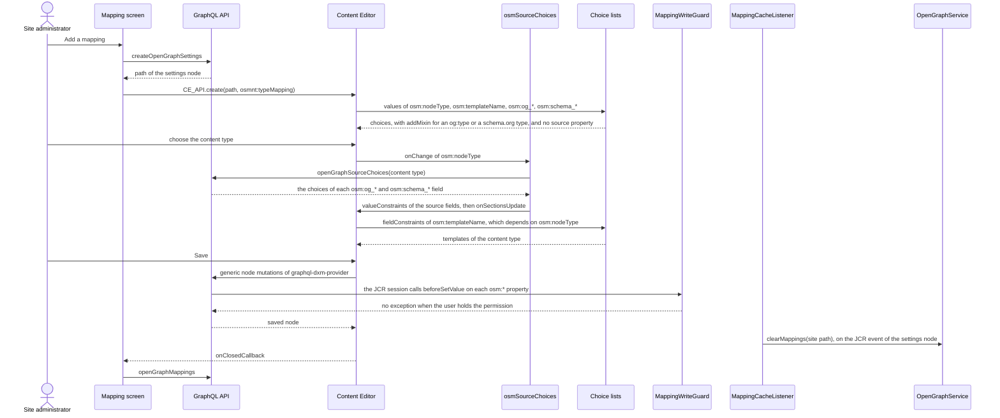
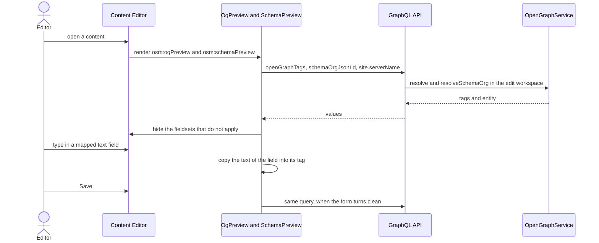

# Runtime View

## Tags in the head of a page

The filter applies to the `page` configuration, in live mode and in preview mode, for the `html` template type, and not
to an Ajax request. Its condition `ModuleOnSiteCondition` requires the module on the site of the request. When the HTML has no `</head>`,
or when no mapping applies, the filter returns the HTML unchanged. A `RepositoryException` writes a warning to the log
and leaves the page unchanged.

`OpenGraphFilter.absoluteUrl` builds the absolute URL of a node in the live workspace, in both modes, so a preview page
gives the URLs of the live page:

- A file gives the HTTP path of its provider, `/live`, then its escaped path, the form of `JCRNodeWrapper.getUrl`.
- A page or a main resource gives its URL under `/cms/render/live/<language>`, after the outbound rules of
  `UrlRewriteService`, so the URL holds a vanity URL.
- A relative URL takes the server of the render context as its prefix.

## Creation of a mapping

`SourcePropertiesInitializer` lists the source properties of the stored content type of the mapping, so the source
fields of a new mapping open empty, and those of an existing mapping open with their choices. The source fields declare
no `dependentProperties`: the Content Editor sends one `fieldConstraints` query for each field that depends on another
when the form opens, and its query of the publication info, which enables Save, waits behind them
([opengraph-schemaorg-metadata#66](https://github.com/Jahia/opengraph-schemaorg-metadata/issues/66)). Instead,
[`init.tsx`](../../src/javascript/init.tsx) registers the handler `osmSourceChoices` of `selectorType.onChange`, which
loads [`sourceChoices.ts`](../../src/javascript/open-graph-settings/sourceChoices.ts) when `osm:nodeType` changes. When
the content type differs from the one whose source properties the lists hold, the handler sends one query
`openGraphSourceChoices` and writes the choices into every source field, the fields of the dynamic fieldsets included.
The form of an existing mapping offers its own content type only, so it sends no query. `SourceChoices` filters the
source properties of a field for the choice list and for `openGraphSourceChoices`, so both offer the same choices.

The Content Editor saves the mapping through the generic mutations, so this scenario does not call
`saveOpenGraphMapping` and its validation. The choice lists call the same methods of the service as that validation, so
each list offers only the values that the validation accepts. `ContentTypesInitializer` and `TemplatesInitializer`
leave out a content type and a template that a mapping of the site already uses. In the form of an existing mapping,
they list its own value only.

## Values of a content in the Content Editor

A tag whose `sourceProperty` names a single-valued text field shows the text of that field as the editor types.
`plainText.ts` removes the markup of a rich text with the same steps as `OgValues.plainText` on the server. Another
change shows the hint "Save to see the updated Open Graph values", and the values change after the save.

## Selection of the mapping of a content

`OpenGraphService.findMapping` selects one mapping for a node:

1. The template mappings whose template is the `j:templateName` of the node, then the mappings of every template.
2. In each group, a mapping of a mixin of the node or of a supertype of that mixin, in the order of the list.
3. Then the mapping of the primary type of the node.
4. Then the mapping of the closest supertype of the primary type.

The first match wins. When the mapping has no og:type, `resolve` returns no tag. When it has no schema.org type,
`resolveSchemaOrg` returns an empty entity.
