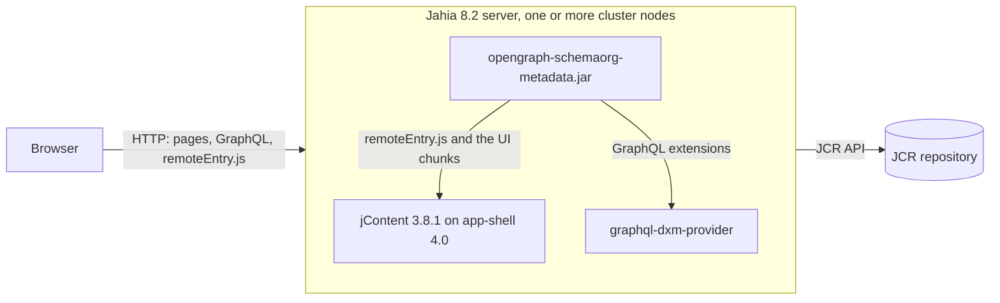

# Deployment View

## Infrastructure Level 1

| Element | Content |
|---|---|
| `opengraph-schemaorg-metadata-<version>.jar` | The OSGi bundle: the Java classes, the CND, the forms files, the import files, the resource bundles and the UI under `javascript/apps/`. |
| Jahia server | Jahia 8.2 with the modules `default`, `graphql-dxm-provider`, `jcontent` 3.8.1 and `app-shell` 4.0. |
| Cluster | `MappingCacheListener` implements `ExternalEventListener`, so a change on one cluster node clears the cache on every node. |
| Site | The module must be active on a site. The render filter and the admin route check it. |

## Infrastructure Level 2

### Build of the bundle

`mvn -s .github/maven.settings.xml clean install` runs `frontend-maven-plugin`. The plugin installs Node `v22.14.0` and
runs `yarn install` and `yarn build`. Vite writes the UI to `src/main/resources/javascript/apps/`, and
`maven-bundle-plugin` builds the bundle with the Declarative Services annotations. The profile `dev` runs
`yarn build:dev` instead.

### Test environment

[`tests/docker-compose.yml`](../../tests/docker-compose.yml) starts a Jahia container and a Cypress container. The
provisioning manifests install `grid` 8.1.0 and `news` 3.4.0, then every `*-SNAPSHOT.jar` of `artifacts/`. The workflow
[`on-code-change.yml`](../../.github/workflows/on-code-change.yml) runs the build, the static analysis, the integration
tests and the Sonar analysis on each pull request.
