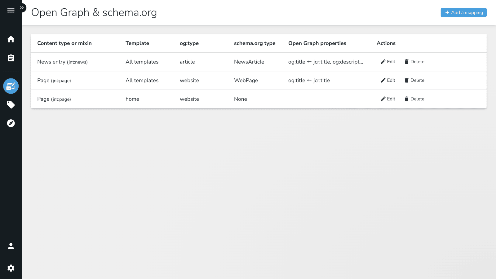
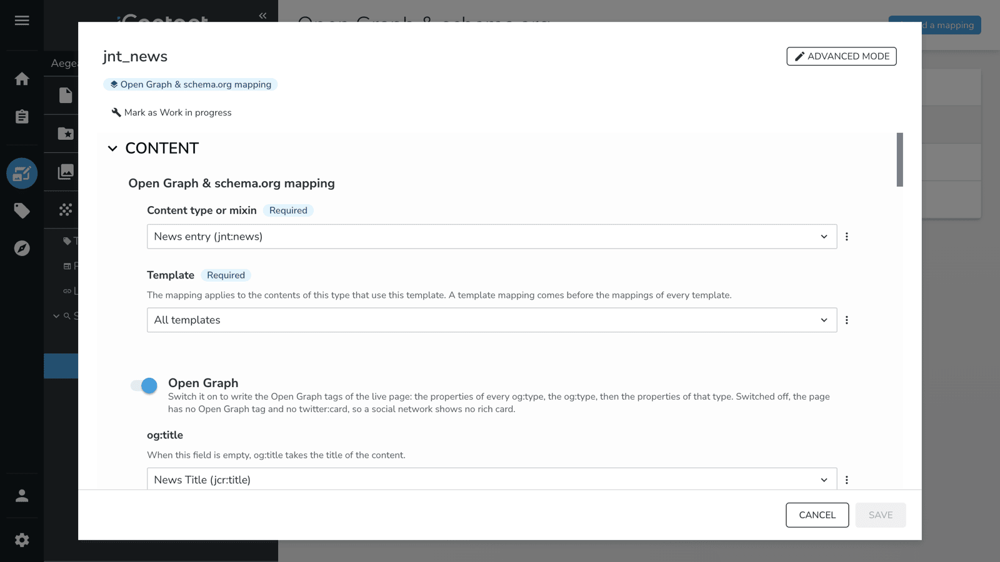
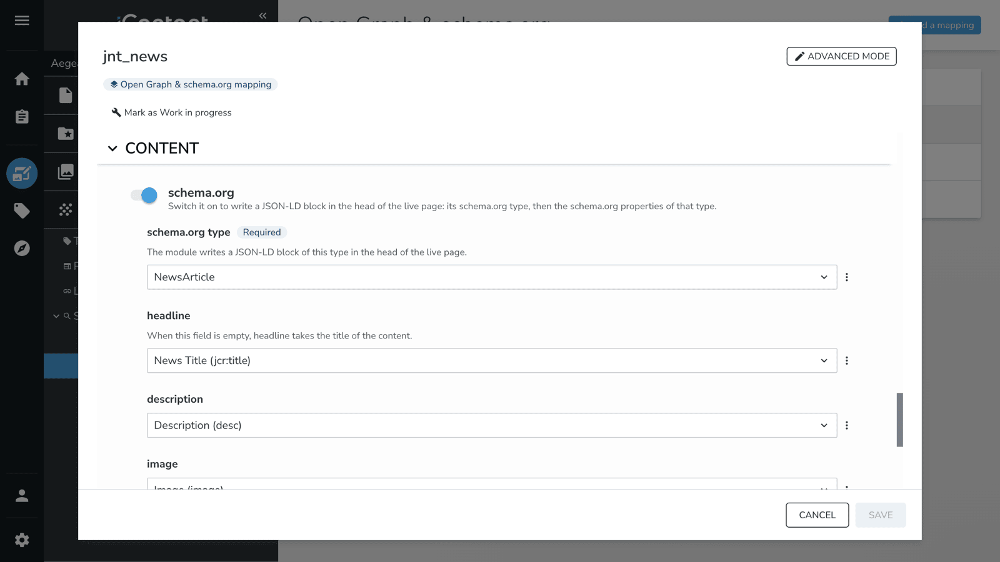
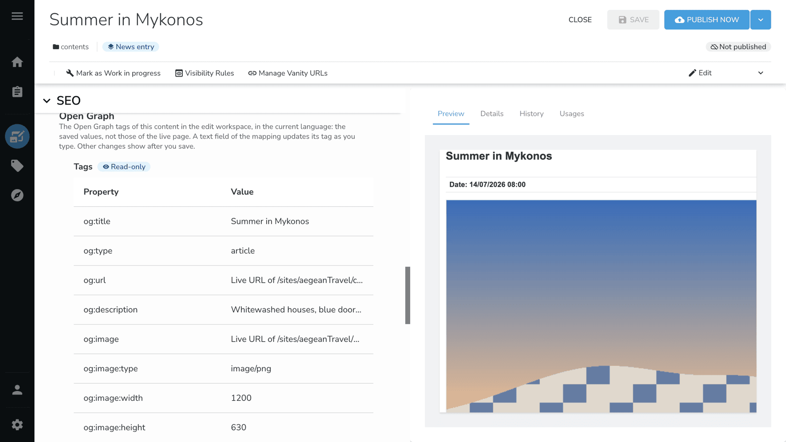
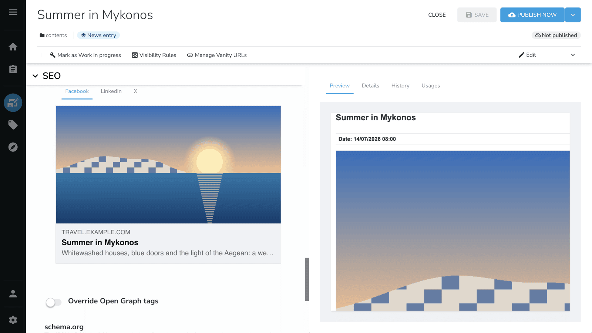
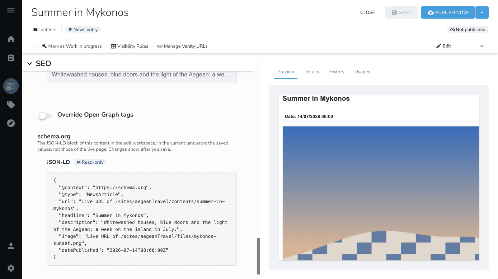
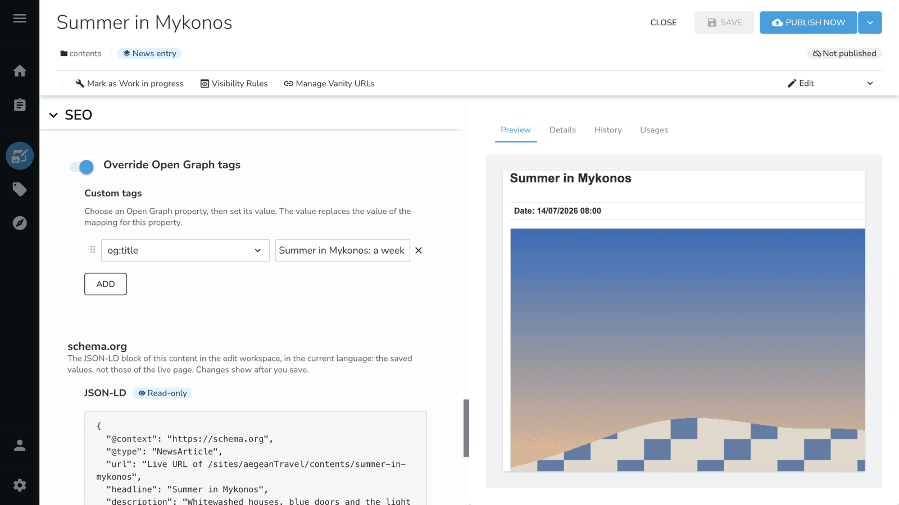
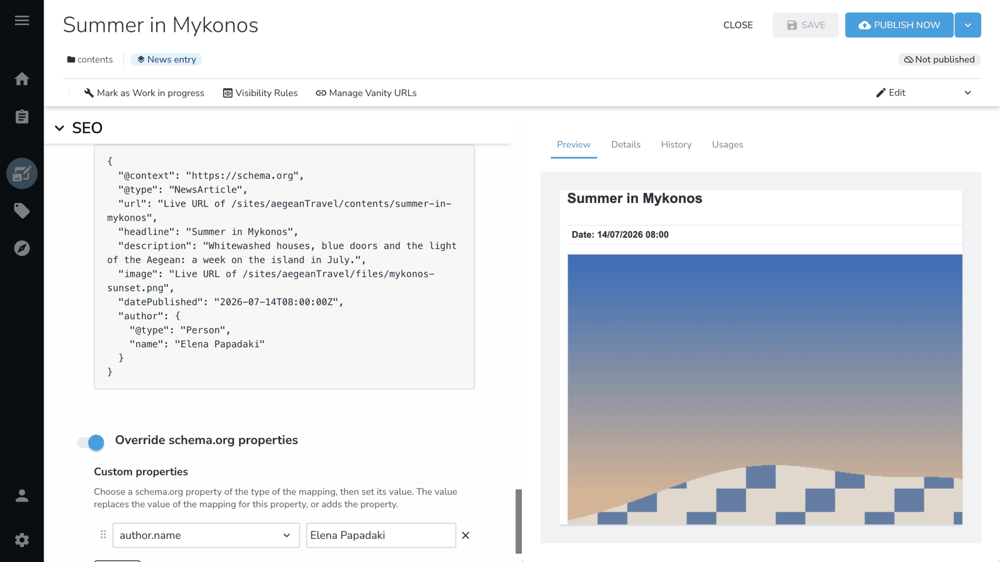

# Open Graph & Schema.org Metadata

Open Graph & Schema.org Metadata writes the Open Graph tags and a schema.org JSON-LD block in the head of your live
pages. The values come from the content that your editors already write, so you change no template.

## Overview

The module is not meant for a site whose templates already write the Open Graph tags or the schema.org values. The
module adds its tags to the head of the page, and does not read the tags that a template wrote. A page of such a
template would then hold both sets of tags. When only a few templates write their own values, give each of them a
template mapping with both switches off. The section
[the mapping that applies to a content](#the-mapping-that-applies-to-a-content) states how.

You map a content type to an Open Graph type and to a schema.org type once, in jContent. The module then writes the
tags of every content of that type:

- A link to the page shows a rich card on Facebook, LinkedIn and X, with its title, description and image.
- Search engines read a schema.org block of the type of the content, such as `NewsArticle`, `Event` or `Product`.
- A change of a mapping applies to the live pages at once, with no publication.
- Editors see the values of each content in the Content Editor, with a preview of its share card.
- Editors find the same tags in the head of a page in preview mode, with the URLs of the live page.
- An editor can replace a value for one content, such as a shorter title for social networks.

## Set a mapping

A site administrator or an editor in chief sets the mappings of a site.

1. In jContent, open **Additional**, then **Open Graph & schema.org** in the group **SEO**.
2. Click **Add a mapping**.
3. In **Content type or mixin**, choose the type of the contents, such as **News entry**.
4. In **Template**, keep **All templates**, or choose one template of the content type. A page has the page templates
   of the site, and a full-page content, such as a news entry, has the content templates made for its type. The
   field is read-only until you choose a content type, and for a mixin.
5. Switch on **Open Graph**. For each Open Graph property, choose the property of the content that fills it.
6. In **og:type**, choose the type of the contents, such as `article`. Then fill the properties of that type.
7. Switch on **schema.org**. In **schema.org type**, choose a type, then fill its properties.
8. Click **Save**.

### What a mapping can map

- **Content types:** `jnt:page`, each type that inherits `jmix:mainResource`, and each mixin that extends one of
  them. The list shows only the types of the modules of the site.
- **Open Graph types:** `website`, `article`, `book`, `profile`, `music.song`, `music.album`, `music.playlist`,
  `music.radio_station`, `video.movie`, `video.episode`, `video.tv_show` and `video.other`.
- **schema.org types:** `Article`, `NewsArticle`, `BlogPosting`, `WebPage`, `ProfilePage`, `Product`, `Event`,
  `Recipe` and `VideoObject`. A property with a dot, such as `author.name`, fills a nested entity, such as the
  `Person` of the author.
- **Source properties:** a field offers only the properties whose values fit it. For example, `og:image` offers the
  image fields of the type, and `article:published_time` offers its date fields.

Several fields can use the same source property, such as the title of the content for `og:title` and for `headline`.
The module never fills an empty field of one vocabulary from the other.

### Values that the module sets

The module sets these values itself, so the form does not show them:

- `og:type`, `og:url`, `og:site_name`, `og:locale` and `og:locale:alternate`.
- The type, the width and the height of the image of `og:image`.
- `twitter:card`: `summary_large_image` when the page has an image, and `summary` otherwise.
- The schema.org `url` of the content.

When no field fills `og:title`, the tag takes the title of the content. The first property of a schema.org type,
such as `headline`, also takes the title of the content when no field fills it.

### The mapping that applies to a content

One mapping applies to a content. The module chooses it in this order:

1. A mapping for the template of the content.
2. A mapping of a mixin of the content.
3. The mapping of its type, then the mapping of its closest parent type.

A mapping with both switches off writes nothing. So a template mapping can stop the module on a template that writes
its own tags.

## In the Content Editor

The **SEO** section of the Content Editor shows four fieldsets for a content that a mapping applies to. Each
vocabulary shows its values first, then the switch that overrides them.

The values are those of the saved content in the language of the form, and not those of the live page. A text
field of the mapping updates its tag while the editor types. Other changes show after the editor saves.

### Open Graph

The table lists the Open Graph tags of the content. Below it, the share card shows the content as Facebook, LinkedIn
and X show a link to it.

### schema.org

The JSON-LD block of the content shows as formatted JSON. A link to a content or to a file shows as "Live URL of"
followed by its path. The live URL itself depends on the host name of the site.

### Override Open Graph tags and Override schema.org properties

Switch on **Override Open Graph tags** to replace a mapped value for this content. Choose an Open Graph property,
then type its value, or pick an image for an image property. **Override schema.org properties** works the same way,
and can also add a property that the mapping does not fill.

The Content Editor refuses to save a custom Open Graph tag with a date that is not valid. It also refuses a URL that is
not absolute, such as `videos/summer.mp4`.

When a vocabulary is off in the mapping, its values fieldset says so, and its override fieldset does not show. When
no mapping applies to the content, the Content Editor shows none of the four fieldsets.

## Permissions

The module adds the permission `openGraphSchemaOrgMetadataManage` under the permission group `site-admin`. The role
`site-administrator` holds `site-admin`, and the module grants the permission to the role `editor-in-chief`. A user without this permission
does not see the mapping screen, and cannot create or change a mapping through any API. An editor needs no extra
permission to see the values or to override them in the Content Editor.

## Installation

The module needs:

- Jahia 8.2.2.0 or later.
- jContent 3.8.1 or later, and app-shell 4.

Install the module, then enable it on each site that needs the tags. The module writes tags only on the sites where
it is enabled.

## Limits

- The module writes no site-wide schema.org type, such as `WebSite`, `Organization` or `BreadcrumbList`.
- A user who can write the site can still remove a mapping without `openGraphSchemaOrgMetadataManage`.
